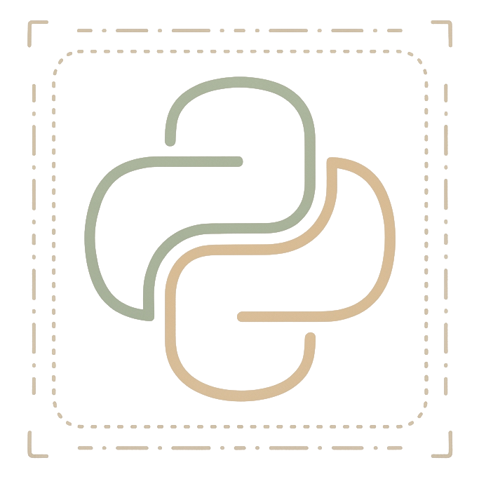

# Python Template

<p align="center">
    <a href="https://github.com/gitUmaru/python-template" target="_blank">
    
    </a>
</p>

<p align="center">
A minimal, opinionated starting point for new Python projects: a clean <code>src</code> layout managed with <a href="https://docs.astral.sh/uv/">uv</a>.
</p>

## About

This is a template repository. Use it as the starting point for a new Python
project so you don't have to set up the same scaffolding every time. Click
**Use this template** on GitHub (or clone it) and start building.

## Requirements

- [Python](https://www.python.org/) 3.10 or newer
- [uv](https://docs.astral.sh/uv/) for environment and dependency management

Install uv if you don't have it yet:

```bash
# macOS / Linux
curl -LsSf https://astral.sh/uv/install.sh | sh

# Windows (PowerShell)
powershell -c "irm https://astral.sh/uv/install.ps1 | iex"
```

## Setup / Installation

```bash
# clone the template (or use the "Use this template" button on GitHub)
git clone https://github.com/gitUmaru/python-template.git my-project
cd my-project

# install dependencies into a local .venv
uv sync
```

Add dependencies with `uv add <package>`, and remove them with
`uv remove <package>`.

## Running

Run your code inside the managed environment with `uv run`:

```bash
# run the package
uv run python -m src

# or run a specific script
uv run python src/your_script.py
```

## Project Structure

```
python-template/
  src/            your package code
  assets/         images and static files
  pyproject.toml  project metadata and dependencies
  README.md
  LICENSE
```

## Development

Run any tool inside the project environment with `uv run`:

```bash
# run tests
uv run pytest

# format and lint (if you add ruff)
uv run ruff format .
uv run ruff check .
```

## Customizing the Template

After creating a project from this template:

1. Rename the `src/` package (or the project) to match your project name.
2. Update `pyproject.toml` with your project's name, description, and authors.
3. Replace this README with one that describes your project.
4. Swap out the logo in `assets/` if you'd like.

## Contributing

1. Fork the repository and create a feature branch.
2. Make your changes and add tests where appropriate.
3. Open a pull request describing what you changed and why.

## License

Distributed under the GNU Affero General Public License v3.0. See
[LICENSE](LICENSE) for details.
